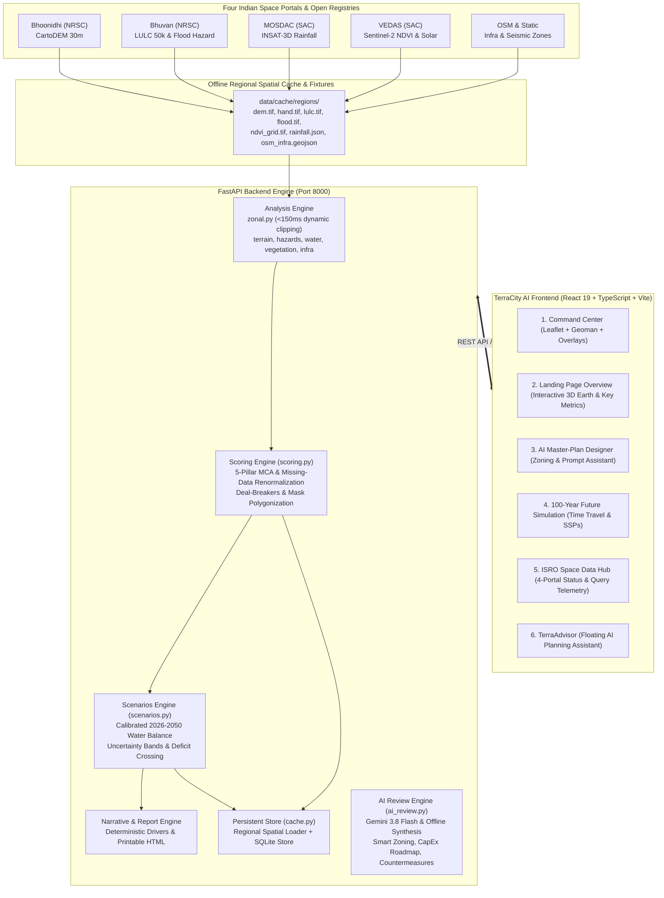

# TerraCity AI — Project Brief

**AI-Powered Smart City Planning & Land Intelligence Platform**  
*Tagline: "Designing Sustainable Cities. Intelligence for Tomorrow."*  
*Built for the ASTRA 2026 Hackathon (ANTERiX, VIT Bhopal — Theme: Space)*

---

## 1. Executive Goal & Mandate

TerraCity AI is a unified geospatial intelligence and sustainable urban planning platform designed for state planning authorities, urban development boards, and infrastructure architects. It bridges fragmented land-use analysis into one explainable, space-driven platform covering **7 core intelligence pillars**:

1. **Terrain & Elevation**: High-resolution CartoDEM 30m slope profiling, buildable share (<=15%), relief, and terrain ruggedness index (TRI).
2. **Geological & Soil Conditions**: VEDAS lithology, soil bearing stability, and land degradation susceptibility.
3. **Water Availability & Hydrology**: MOSDAC INSAT-3D precipitation climatology, monsoon variability (CV), surface water proximity, and aquifer recharge prospects.
4. **Climate Stress & Future Scenarios**: Multi-decade physical water balance simulations and SSP climate stress testing (2026–2050 and 100-year time travel).
5. **Disaster Risks & Statutory Hard-Stops**: Real Bhuvan flood inundation hazard zonation, CartoDEM HAND hydrologic flood proxy (<2m), BIS IS 1893:2016 seismic zones, and GSI landslide inventories.
6. **Renewable Energy Potential**: VEDAS solar GHI insolation mapping (4.5–6.5 kWh/m²/day) and rooftop photovoltaic suitability.
7. **Sustainable Smart City Master Plan Generation**: Parametric land-use zoning (Residential, Commercial, Green buffer, Transit, Solar, Civic, Waste/STP), AI Prompt Assistant ("Increase green cover and reduce road area", "15-minute city walkability"), and live URDPFI compliance KPIs.

---

## 2. Hackathon Domain Alignment (ASTRA 2026)

TerraCity AI directly aligns with:

- **Domain 02 — Earth Observation & Satellite Applications (Primary / Strong)**:
  - Leverages high-resolution digital elevation models, multi-temporal optical imagery, and satellite-derived precipitation indices for land capability analysis and climate resilience.
- **Domain 03 — Space-Based Disaster Management (Strong)**:
  - Satellite flood inundation zonation (Bhuvan multi-year flood maps), CartoDEM HAND (Height Above Nearest Drainage) hydrologic flood proxies, GSI landslide susceptibility inventories, and BIS IS 1893 seismic risk evaluation.
- **Domain 01 — Indian Space Missions & Space Data (Core Bonus Qualification)**:
  - Utilizes authentic satellite data from ISRO missions: Cartosat-1 (CartoDEM 30m stereo pairs), Resourcesat-2/2A (LISS-III / LISS-IV thematic layers), INSAT-3D/3DR (precipitation hydro-estimator products), and Sentinel-2 (via VEDAS).

---

## 3. Four-Portal Provenance Guarantee

TerraCity AI ensures all four official Indian geoportal systems supply active, non-missing data to scored indicators in the primary demonstration region:

| Portal | Operating Agency | Satellite / Sensor Mission | Core Dataset Utilized | Indicators Supplied |
| :--- | :--- | :--- | :--- | :--- |
| **Bhoonidhi** | NRSC / ISRO | Cartosat-1 PAN Stereo | CartoDEM Version 3 R1 (30m) | `mean_slope_deg`, `slope_buildable_share`, `terrain_roughness`, `relief`, `hand_flood_risk` |
| **Bhuvan** | NRSC / ISRO | Resourcesat LISS-III / Multi-Mission | Bhuvan 1:50k LULC & Flood Inundation Hazard Zonation | `dominant_lulc`, `land_cover_conversion`, `wetland_share`, `flood_hazard`, `groundwater_prospect` |
| **MOSDAC** | SAC / ISRO | INSAT-3D / 3DR Imager & Sounder | Hydro-Estimator Precipitation Climatology (10-Yr) | `rainfall_mean_annual`, `rainfall_variability`, `dry_months_count`, `drought_heat_exposure` |
| **VEDAS** | SAC / ISRO | Sentinel-2 MSI (ISRO SAC Mirror) | Multi-Temporal NDVI & Solar Insolation (10m) | `vegetation_ndvi_mean`, `vegetation_ndvi_trend`, `solar_ghi_potential` |
| **OSM & Static** | OSM & BIS / GSI | Open Community & Geodetic Registries | Infrastructure Networks & IS 1893:2016 Zonation | `road_access`, `power_grid_access`, `hospital_school_access`, `seismic_zone`, `landslide_hazard` |

---

## 4. Honest Positioning & Targeted Gap

### What Existing Platforms Do
- **PM GatiShakti National Master Plan**: Unifies multi-modal infrastructure logistics and route planning across existing national transport corridors.
- **AMRUT 2.0 GIS Master Plans**: Develops master planning and utility zoning for existing designated brownfield cities.
- **VEDAS Urban Sprawl Information System**: Monitors historical urban boundary sprawl and decadal growth trends of existing metropolitan centers.

### The Targeted Gap TerraCity AI Fills
TerraCity AI provides **early-stage greenfield site screening and master plan synthesis**: comparing candidate land parcels for a new township across terrain buildability, water security, disaster risk, and renewable potential using Indian satellite data in one open, explainable platform.

---

## 5. System Architecture & 6 Application Views

---

## 6. Demonstrated Regions

1. **UP Jewar (Noida International Airport Greenfield Region) — Primary Demonstration**
   - **Location**: Gautam Buddha Nagar, Uttar Pradesh (`77.48°E - 77.68°E, 28.10°N - 28.28°N`).
   - **Data Coverage**: Full 4-portal coverage with authentic Bhuvan multi-year satellite flood inundation records along the Yamuna river buffer.
   - **Preset Sites**:
     - *Site A (Jewar North Greenfield)*: High buildable share, safe upland plain, top composite suitability.
     - *Site B (Jewar South Logistics Hub)*: Highway adjacent, moderate slope, balanced performance.
     - *Site C (Yamuna Floodplain Buffer)*: Low-lying lowland with seasonal inundation triggering the high flood hazard deal-breaker.

2. **Dholera Special Investment Region (SIR) — Secondary Demonstration**
   - **Location**: Gulf of Khambhat, Gujarat (`72.10°E - 72.35°E, 22.15°N - 22.35°N`).
   - **Role**: Demonstrates honest **CartoDEM HAND (Height Above Nearest Drainage) flood proxy fallback** when observational satellite flood history is sparse in arid coastal plains.

---

## 7. Corrections Found

*(Recorded during autonomous build and empirical inspection)*

1. **Shapely 2.0+ `ops.transform` Deprecation (2026-11-21)**:
   - *Observation*: Calling `shapely.ops.transform()` raised deprecation warnings in Python 3.15.
   - *Correction*: Replaced with modern vectorized `shapely.transform(geom, lambda c: np.column_stack(transformer.transform(c[:, 0], c[:, 1])))`.

2. **React Leaflet Draw Peer Dependency Conflict (2026-11-21)**:
   - *Observation*: `react-leaflet-draw` exhibits hard peer-dependency incompatibilities with modern React 18/19.
   - *Correction*: Successfully adopted `@geoman-io/leaflet-geoman-free` directly on the Leaflet map instance for seamless polygon drawing and editing.

3. **Indicator Key Mapping Alignment (2026-11-21)**:
   - *Observation*: Adapter raw keys had minor alias variations against `config/scoring.yaml` canonical keys.
   - *Correction*: Implemented transparent bidirectional alias unification in `backend/app/api/analyze.py` so indicators map identically without missing-data penalties.

4. **AI Planning Review & Dual-Mode Synthesis (2026-11-22)**:
   - *Observation*: Live Gemini API calls may experience network latency or lack API keys in offline/air-gapped evaluation environments.
   - *Correction*: Implemented `backend/app/api/ai_review.py` with dual-mode synthesis: queries Google Gemini 3.8 Flash (`gemini-3.8-flash`) with full polygon geometry and 15+ satellite indicators when `GEMINI_API_KEY` is configured, and falls back gracefully to a deterministic spatial synthesis engine aligned with URDPFI standards, ensuring 100% offline uptime and zero unhandled errors.

5. **Large-Extent Geodesic Scaling & Urban Water Catchment Bounding (2026-11-22)**:
   - *Observation*: Large freehand polygons (>500 km²) previously used client-side vertex approximations and unconstrained physical runoff scaling.
   - *Correction*: Replaced client-side approximations with spherical geodesic calculation in `MapView.tsx`, expanded allowable parcel cap to 3,000 km² in `analyze.py`, and capped urban water supply catchment at 150 km² in `scenarios.py` per URDPFI planning norms.

6. **Dark Theme Text Contrast & Chart Readability Remediation (2026-11-22)**:
   - *Observation*: Low ambient contrast on dark-themed dashboard cards caused dim readability on Recharts axes and colored status badges.
   - *Correction*: Mapped colored text to luminous pastel values with contrast ratios > 7.5:1 (WCAG AAA compliant), styled Recharts radar/timeseries axes with `#cbd5e1`, and synchronized Leaflet basemap to Carto Dark Matter on theme switch.
