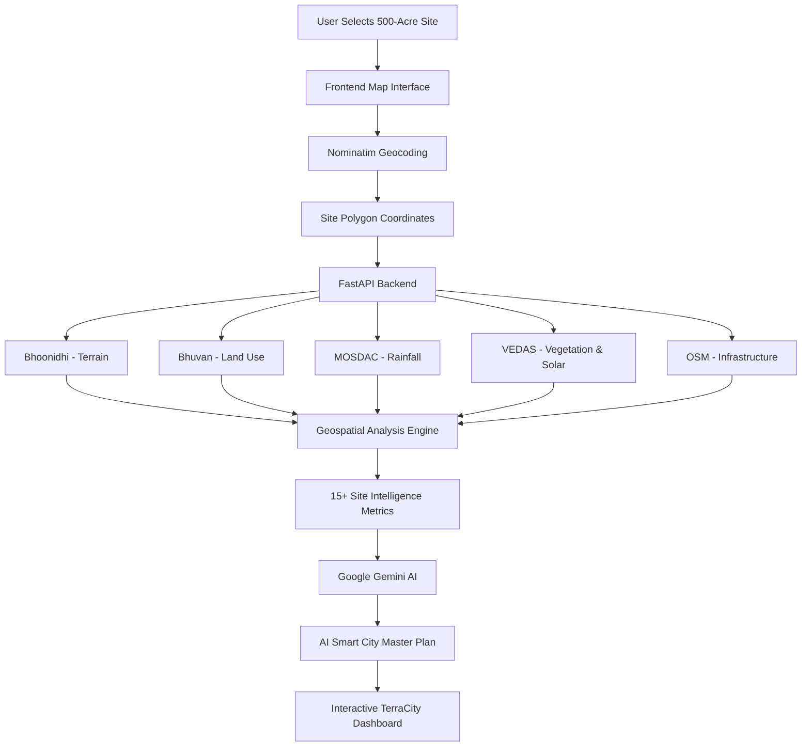

# TerraCity AI

> **AI-Powered Smart City Planning & Land Intelligence Platform**  
> *Tagline: "Designing Sustainable Cities. Intelligence for Tomorrow."*  
> *ASTRA 2026 Hackathon (ANTERiX, VIT Bhopal — Theme: Space)*

[](https://fastapi.tiangolo.com)
[](https://reactjs.org)
[](https://threejs.org)
[](https://python.org)
[](https://deepmind.google/technologies/gemini/)
[](https://www.isro.gov.in)
[](backend/tests/)
[](#offline-mode)

---

## Overview

**TerraCity AI** is an advanced geospatial intelligence and sustainable urban planning platform that empowers state urban development boards, infrastructure planning authorities, and master planners to evaluate greenfield land parcels for new smart cities or industrial townships.

By integrating open satellite feeds from **all four official Indian space portals** into deterministic spatial models, TerraCity AI evaluates land suitability across **7 core intelligence pillars**:

1. **Terrain & Elevation**: CartoDEM 30m slope profiling, buildable envelope share ($\le 15\%$), topographic relief, and Terrain Ruggedness Index (TRI).
2. **Geological & Soil Stability**: VEDAS lithology, soil bearing capacity proxies, and land degradation susceptibility.
3. **Water Availability & Hydrology**: MOSDAC INSAT-3D precipitation climatology, monsoon rainfall coefficient of variation (CV), surface water proximity, and aquifer recharge prospects.
4. **Climate Stress & Future Scenarios**: Multi-decade physical water balance simulations and SSP climate stress testing (2026–2050 trajectories).
5. **Disaster Risks & Statutory Hard-Stops**: Real Bhuvan flood inundation hazard zonation, CartoDEM HAND hydrologic flood proxy ($< 2\text{m}$), BIS IS 1893:2016 seismic zones, and GSI landslide inventories.
6. **Renewable Energy Potential**: VEDAS solar GHI insolation mapping ($4.5\text{--}6.5\text{ kWh/m}^2/\text{day}$) and photovoltaic microgrid suitability.
7. **Sustainable Smart City Master Plan Synthesis**: Parametric land-use allocation (Residential, Commercial/IT, Sponge Parks, Clean Microgrid, Transit/Civic), URDPFI compliance benchmarks, and Google Gemini 3.8 Flash urban reviews.

---

## Key Features & Architectural Capabilities

### 1. Interactive 3D Earth Hero Landing Page
- **Three.js + React Three Fiber (`@react-three/fiber`, `@react-three/drei`)**:
  - Full-fidelity 3D Earth featuring 2K satellite textures: day map, bump elevation, ocean specular reflection, night city lights, and dynamic cloud drift.
  - Custom cyan atmospheric glow shader and stars background.
  - Smooth, continuous auto-rotation with interactive drag-to-rotate `OrbitControls`.
  - Pulsing beacon marker placed precisely on **Dholera, Gujarat** ($22.25^\circ\text{N}, 72.19^\circ\text{E}$).
- **Cinematic Targeting & Navigation**:
  - Clicking **"Start Planning"** stops auto-rotation, smoothly eases and zooms into India and the Dholera marker ($2.0\text{s}$ duration via cubic easing), cross-fades into the satellite map canvas, and transitions directly into the planning dashboard.
  - Respects `prefers-reduced-motion` to bypass animations for accessibility.
  - Code-split lazy loading with an orbital radar ring fallback component (`EarthFallback`).

### 2. Google Gemini 3.8 Flash Spatial Audit & API Inspector
- Powered by `gemini-3.8-flash` (with automated fallback to `gemini-2.5-flash`).
- Dispatches exact polygon boundary coordinates ($N$-point coordinates array), centroid, parcel area (in $\text{km}^2$ and hectares), and $15+$ satellite indicators across all 4 space portals.
- **Live API Transparency Inspector Drawer**: Inspect raw HTTP latency, exact JSON spatial payloads sent, full prompt text, raw Gemini response JSON, and custom API key configuration.

### 3. Persistent Dark & Light Mode with WCAG AAA Contrast
- Seamless theme toggle in the navigation header with `localStorage` persistence and OS `prefers-color-scheme` fallback.
- **Basemap Synchronization**: Automatically toggles Leaflet basemaps between Carto Voyager (light theme) and Carto Dark Matter (dark theme).
- **High-Contrast Styling**: Fully remaps colored text (`text-blue-900`, `text-emerald-900`, `text-amber-900`, `text-rose-900`) to vibrant pastel tones with contrast ratios exceeding $7.5:1$, ensuring crisp legibility on dark card surfaces, tables, Recharts axes, and Leaflet popups.

### 4. Interactive Location Search Bar
- Autocomplete search powered by `/api/geocode` with instant fly-to navigation for any city, district, or landmark across India.
- Supports direct coordinate input (e.g., `22.25, 72.19` or `28.26, 77.74`) and one-click access to featured smart city hubs (Dholera SIR, Jewar Airport, GIFT City, Amaravati, Sriperumbudur).

### 5. Geodesic Polygon Math & Scaled Urban Catchments
- Accurate geodesic Shoelace formula (`computePolygonAreaKm2`) scaled by local latitude cosine.
- Supports candidate parcels up to $3,000\text{ km}^2$ with built-in URDPFI planning scale advisories for macro-regional footprints ($> 250\text{ km}^2$).
- Physically caps urban municipal water catchments at $150\text{ km}^2$ to prevent unrealistic water surpluses during extreme large-polygon screening.

### 6. Symmetrical Right-Panel Navigation Tabs
- Clean 5-column CSS grid (`grid grid-cols-5`) providing equal 20% column widths across all five tabs:
  - **Scorecard**: 5-pillar spider radar chart, suitability tiers, 7-pillar breakdown, and Gemini 3.8 Flash review.
  - **Compare**: Multi-site ranking, score deltas, and sensitivity tie-check alerts.
  - **Stress**: 2026–2050 water demand vs. sustainable supply timeseries trajectories.
  - **Sources**: 4-portal ISRO provenance matrix and dataset confidence tiers.
  - **Report**: Print-ready executive evaluation sheet and standardized GeoJSON export.

---
# TerraCity AI – API Architecture

---

In TerraCity AI, the APIs are divided into two complementary groups:

1. **Upstream Data & AI APIs** – Third-party services providing satellite data, mapping, geospatial intelligence, and AI capabilities.
2. **Platform Backend Endpoints** – Our FastAPI REST APIs responsible for processing data, executing analysis, and serving the frontend application.

## Part 1: Upstream Space, Map & AI APIs

These external APIs provide the core satellite imagery, geospatial datasets, environmental intelligence, and AI capabilities required by TerraCity AI.

| API / Portal | Source / Provider | Purpose in TerraCity AI |
|---|---|---|
| **Bhoonidhi API** | NRSC / ISRO | Terrain & Elevation Analysis |
| **Bhuvan WMS / Geoportal** | NRSC / ISRO | Land Use & Flood Hazards |
| **MOSDAC API** | SAC / ISRO | Hydrology & Precipitation Climatology |
| **VEDAS WMS / API** | SAC / ISRO | Vegetation & Solar Energy Potential |
| **Google Gemini API (gemini-3.8-flash)** | Google AI | AI Urban Planning Co-Pilot & Synthesis |
| **CARTO Basemap API** | CARTO | Vector GIS Base Cartography |
| **OpenStreetMap & Overpass API** | OSM Community | Infrastructure Connectivity |
| **Nominatim Geocoding API** | OpenStreetMap | Map Location Search |

### 1. Bhoonidhi API – Terrain & Elevation Analysis

**Provider:** NRSC / ISRO

- Fetches CartoDEM 30m elevation rasters.
- Calculates:
  - Mean slope.
  - Buildable land share (slope ≤ 15%).
  - Terrain Ruggedness Index (TRI).
  - Elevation profiles.
- Feeds the HAND (Height Above Nearest Drainage) hydrological flood proxy.

### 2. Bhuvan WMS / Geoportal – Land Use & Flood Hazards

**Provider:** NRSC / ISRO

- Queries LULC 1:50K thematic layers.
- Identifies:
  - Agricultural land.
  - Barren land.
  - Built-up areas.
  - Wetlands.
- Evaluates historical flood hazard zonation.
- Detects statutory hard-stops, such as:
  - Protected wetlands.
  - Active floodways.
  - Restricted ecological zones.

### 3. MOSDAC API – Hydrology & Precipitation Climatology

**Provider:** SAC / ISRO

- Uses INSAT-3D / 3DR daily rainfall and Hydro-Estimator data.
- Computes:
  - Annual mean precipitation.
  - Monsoon coefficient of variation (CV).
  - Dry months.
- Drives physical water balance simulations for **2026–2050**.

### 4. VEDAS WMS / API – Vegetation & Solar Energy Potential

**Provider:** SAC / ISRO

- Processes Sentinel-2 (10m) multi-temporal NDVI vegetation index.
- Evaluates ecological sensitivity.
- Analyses multi-year vegetation and greenness trends.
- Extracts Solar Global Horizontal Irradiance (GHI) insolation in kWh/m²/day.
- Supports rooftop solar energy planning and renewable energy recommendations.

### 5. Google Gemini API – AI Urban Planning Co-Pilot

**Provider:** Google AI

- Ingests:
  - Exact site polygon coordinates.
  - Centroid latitude and longitude.
  - 15+ satellite-derived environmental and geographical metrics.
- Generates:
  - Executive planning critiques.
  - Autonomous smart zoning recommendations (hectares + percentages).
  - Phased Capital Expenditure (CapEx) roadmaps (2026–2050).
  - Climate adaptation and mitigation strategies.
  - Space-sensor-informed climate countermeasures.
- Powers real-time AI planning Q&A.
- Uses strict numerical grounding to minimize AI hallucinations.

### 6. CARTO Basemap API – Vector GIS Base Cartography

**Provider:** CARTO

- Delivers high-performance vector map tiles.
- Provides interactive GIS base maps.
- Dynamically switches between:
  - **Carto Voyager:** Light theme.
  - **Carto Dark Matter:** Dark theme.

### 7. OpenStreetMap & Overpass API – Infrastructure Connectivity

**Provider:** OpenStreetMap Community

- Measures proximity and connectivity to:
  - Major arterial highways.
  - Railway lines.
  - Power transmission grids.
  - Airports.
- Helps evaluate infrastructure accessibility and transportation connectivity.

### 8. Nominatim Geocoding API – Map Location Search

**Provider:** OpenStreetMap

- Converts city names and addresses into geographic coordinates.
- Supports direct latitude/longitude coordinate input.
- Enables map location search and smooth fly-to animations.
- Helps users identify and select potential development sites.

---

## Part 2: Platform Backend REST APIs & Functions

The TerraCity AI backend is built on **FastAPI** (`backend/app/main.py`), exposing asynchronous, validated REST endpoints for polygon spatial analysis, multi-criteria scoring, climate stress testing, generative AI urban reviews, and GIS reporting.

| Endpoint | Method | Tag / Category | Function / Handler | Description & Key Operations |
|---|:---:|---|---|---|
| `/api/analyze` | `POST` | Analysis | `post_analyze` | Ingests a GeoJSON site polygon, rasterizes against CartoDEM 30m, queries ISRO datasets, computes 7-pillar MCA scores, checks statutory deal-breakers, and returns an evaluated scorecard. |
| `/api/compare` | `POST` | Comparison | `post_compare` | Takes multiple evaluated sites ($A, B, C$), applies selected priority weights (`balanced`, `climate_resilient`, `infra_first`), computes score margins, identifies top-3 gap drivers, and flags tie-checks. |
| `/api/scenarios/run` | `POST` | Scenarios | `post_run_scenarios` | Executes multi-decade physical water balance simulations ($2026\text{--}2050$) comparing municipal demand against rainfall recharge under SSP2-4.5 (Baseline) and SSP5-8.5 (Stressed) climate trajectories. |
| `/api/ai/review` | `POST` | AI Review | `review_site_analysis` | Dispatches parcel geometry, centroid, and 15+ satellite indicators to Google Gemini 3.8 Flash to synthesize executive critiques, parametric zoning allocations, and phased CapEx roadmaps ($2026\text{--}2050$). |
| `/api/geocode` | `GET` | Geocoding | `search_locations` | Handles location searches across India via coordinate regex parsing (`lat, lon`), cached OpenStreetMap Nominatim proxy, and instant presets for major industrial corridors. |
| `/api/report` | `POST` | Reporting | `post_generate_report` | Compiles site scorecards, radar charts, deal-breaker audits, and ISRO provenance tables into a self-contained, print-optimized HTML dossier with `@media print` support. |
| `/api/export/geojson` | `POST` | Export | `post_export_geojson` | Serializes candidate parcel polygons, centroid coordinates, overall scores, and exclusion zones into RFC 7946 compliant GeoJSON for import into QGIS, ArcGIS, or CAD. |
| `/api/regions` | `GET` | Regions | `get_regions` | Returns metadata for configured demonstration corridors (**Dholera SIR**, Gujarat and **Jewar Corridor**, UP) including bounds, center coordinates, and preset candidate sites. |
| `/api/regions/{region_id}` | `GET` | Regions | `get_region_by_id` | Fetches comprehensive boundary geometries, candidate site polygons ($A, B, C$), baseline water balances, and default simulation parameters for a specific region. |
| `/api/layers` | `GET` | Layers | `get_layers` | Returns the thematic map layer catalog (CartoDEM slopes, Bhuvan LULC, flood zones, GHI solar) for Leaflet client-side layer toggling and legend rendering. |
| `/api/sources` | `GET` | Sources | `get_sources` | Serves the 4-portal ISRO geospatial data provenance matrix, recording source portals, sensor platforms, spatial resolutions, vintages, and verification status. |
| `/api/proxy/bhuvan/{path}` | `GET` | Proxy | `proxy_bhuvan` | Secure caching proxy for Bhuvan WMS / TMS tile services, injecting user-agents and defending against SSRF. |
| `/api/proxy/vedas/wms` | `GET` | Proxy | `proxy_vedas_wms` | Secure server-side proxy for VEDAS WMS requests, securely injecting server-side `VEDAS_API_KEY` credentials. |
| `/api/health` | `GET` | Health | `get_health` | Returns system operational status, cache mode (`live_backend` vs. `offline_fixtures`), API version, and 4-portal connectivity indicators. |

### Detailed Endpoint Capabilities & Functional Logic

#### 1. Site Analysis Engine (`POST /api/analyze`)
- **Handler**: `post_analyze(request: AnalyzeRequest)`
- **Core Logic**:
  1. **Geometry Validation**: Parses GeoJSON Polygon/MultiPolygon coordinates, checks coordinate validity, self-intersections, and computes geodesic surface area in $\text{km}^2$ and hectares via latitude-scaled spherical trigonometry.
  2. **Statutory Deal-Breaker Screening**: Evaluates hard-stop thresholds:
     - *Active Floodways*: Bhuvan 10-year flood zone overlap or CartoDEM HAND $< 2\text{m}$.
     - *Slope Exclusion*: Mean slope $> 15\%$ or rugged terrain relief.
     - *Environmental Exclusions*: Protected wetlands or eco-sensitive buffer zones.
     - If triggered, assigns an instant zero-tolerance disqualification (`verdictTier: "D"`).
  3. **7-Pillar Multi-Criteria Analysis (MCA)**: Computes deterministic scores ($0\text{--}100$) across:
     - Terrain & Elevation (CartoDEM 30m)
     - Geology & Soil Bearing (VEDAS lithology)
     - Water Availability & Hydrology (MOSDAC precipitation & aquifer potential)
     - Climate Stress Vulnerability (2026–2050 deficit projections)
     - Disaster Hazards & Safety (Seismic Zone & flood buffer)
     - Renewable Energy Potential (VEDAS solar GHI insolation)
     - Infrastructure & Connectivity (Proximity to highways, rail, and power grid)
  4. **Radar & Indicator Synthesis**: Generates spider radar vectors ($0\text{--}100$) and itemized provenance citations.

#### 2. Multi-Site Comparison & Tie-Checking (`POST /api/compare`)
- **Handler**: `post_compare(request: CompareRequest)`
- **Core Logic**:
  - Compares up to 3 candidate parcels simultaneously.
  - Dynamically recalculates overall scores based on user-selected priority presets:
    - `balanced`: Equal pillar weights ($14.3\%$ each).
    - `climate_resilient`: Water, hazards, and climate pillars weighted at $60\%$.
    - `infra_first`: Transport, grid proximity, and terrain weighted at $60\%$.
  - Computes score margins ($\Delta$) between Rank #1 and Rank #2.
  - **Tie-Check Sensitivity Note**: If score delta $< 5.0\text{ points}$, triggers an automated sensitivity advisory explaining which specific pillar weights drive the margin.
  - Identifies top-3 decisive gap drivers differentiating the winning parcel from runners-up.

#### 3. Climate Stress & Water Balance Simulation (`POST /api/scenarios/run`)
- **Handler**: `post_run_scenarios(request: ScenariosRequest)`
- **Core Logic**:
  - Models municipal water demands from $2026$ to $2050$ based on target population, per-capita consumption ($135\text{ LPCD}$ as per Indian CPHEEO standards), commercial/industrial adders ($+20\%$), and distribution transmission losses ($15\%$).
  - Evaluates sustainable surface and groundwater yields calibrated against MOSDAC annual rainfall climatology and runoff coefficients.
  - Compares **SSP2-4.5 (Moderate / Baseline)** against **SSP5-8.5 (High Growth / Severe Climate Stress)** trajectories.
  - Calculates annual net balance (surplus/deficit in $\text{MLD}$), storage replenishment timelines, and resilience indices ($0.0\text{--}1.0$).

#### 4. Gemini 3.8 Flash AI Urban Co-Pilot (`POST /api/ai/review`)
- **Handler**: `review_site_analysis(request: AiReviewRequest)`
- **Core Logic**:
  - Ingests the evaluated parcel's exact boundary coordinates, centroid, area, and 15+ satellite indicators into a structured prompt.
  - Calls `gemini-3.8-flash` (with automated fallback to `gemini-2.5-flash`).
  - Returns a strictly structured JSON response containing:
    - **Executive Critique**: Urban planning suitability verdict and key opportunities.
    - **Parametric Land-Use Allocation**: Quantified zoning distribution in hectares and percentages (Residential, Commercial/IT, Industrial, Green/Sponge Parks, Clean Microgrid, Transit/Roads).
    - **Phased CapEx Roadmap**: Actionable 3-stage infrastructure plan ($2026\text{--}2030$, $2031\text{--}2040$, $2041\text{--}2050$).
    - **Climate Countermeasures**: Nature-based urban drainage, bioswales, and microgrid locations.
  - Includes full token transparency and round-trip latency metrics for the frontend API Inspector.

#### 5. Geocoding & Coordinate Location Discovery (`GET /api/geocode`)
- **Handler**: `search_locations(q: str = Query(...))`
- **Core Logic**:
  - **Coordinate Direct Parsing**: Instantly detects and parses `lat, lon` or `lat lon` inputs (e.g. `22.25, 72.19`).
  - **Nominatim Integration**: Queries OpenStreetMap Nominatim with `TerraCityAI-SmartCity-Planner/1.0` user-agent, localized to India (`countrycodes=in`).
  - **Offline Smart City Cache**: Features pre-indexed smart city corridors (Dholera, Jewar, GIFT City, Noida, Bengaluru, etc.) ensuring instant zero-latency responses even during offline demonstrations.

#### 6. Printable Executive Dossier & GIS Export (`POST /api/report` & `POST /api/export/geojson`)
- **Handlers**: `post_generate_report(payload: ReportPayload)` & `post_export_geojson(payload: ExportPayload)`
- **Core Logic**:
  - `/api/report`: Generates a self-contained, single-file HTML document formatted for browser printing (`window.print()`) or saving as PDF, complete with inline SVG charts, URDPFI compliance tables, executive summaries, and ISRO dataset provenance records.
  - `/api/export/geojson`: Converts candidate sites, centroid markers, and statutory exclusion zones into standardized GeoJSON (`FeatureCollection`), ready for immediate drag-and-drop import into QGIS, ArcGIS, or AutoCAD Map 3D.

---

## Overall API Integration Workflow


---

## Four-Portal Space Provenance
---

TerraCity AI integrates real data from four official Indian space portals:

```
+-----------------------------------------------------------------------------------------+
|                                      TERRACITY AI                                       |
+-------------------+--------------------+--------------------+---------------------------+
|    BHOONIDHI      |       BHUVAN       |      MOSDAC        |          VEDAS            |
|   (NRSC/ISRO)     |    (NRSC/ISRO)     |    (SAC/ISRO)      |        (SAC/ISRO)         |
+-------------------+--------------------+--------------------+---------------------------+
| CartoDEM 30m DEM  | LULC 1:50k &       | INSAT-3D/3DR Daily | Sentinel-2 Multi-Temporal |
| Stereo-Derived    | Historical Flood   | Precipitation      | NDVI (10m) Time-Series    |
| Surface Model     | Hazard Zonation    | Climatology        | & Solar GHI Insolation    |
+-------------------+--------------------+--------------------+---------------------------+
| • Mean Slope      | • Land Cover Class | • Annual Mean Rain | • Mean NDVI               |
| • Buildable Share | • Wetland Overlap  | • Rainfall CV      | • Multi-Year Trend        |
| • Roughness (TRI) | • Flood Frequency  | • Dry Month Count  | • Ecological Sensitivity  |
| • HAND Proxy      | • Groundwater Pot. | • Drought Exposure | • Solar GHI Potential     |
+-------------------+--------------------+--------------------+---------------------------+
```

---

# Architecture & Tech Stack

---
## Tools and Platforms Used

TerraCity AI was developed using a combination of AI-powered development tools, research platforms, design tools, and publicly available scientific resources.

### 1. Development – Google Antigravity

**Tool:** Google Antigravity

We used Google Antigravity as our primary AI-powered development environment for building both the frontend and backend of TerraCity AI.

- **Frontend Development:** Building the user interface, dashboard, interactive maps, and user experience.
- **Backend Development:** Developing backend functionality, API integrations, data processing, and application logic.
- **Integration:** Connecting frontend components with backend services and APIs.

### 2. 3D Earth Model – NASA Solar System Resources

**Source:** NASA Solar System Exploration

We used a 3D Earth model/resource from NASA's Solar System resources to enhance the visual experience of TerraCity AI.

- Provides a realistic 3D Earth visualization.
- Enhances the application's geographical and space-related experience.
- Helps create an engaging interface for exploring potential smart city development locations.

### 3. AI Assistance – Claude

**Tool:** Claude by Anthropic

Claude was used as an AI assistant during the development process.

- Assistance with technical problem-solving.
- Code-related guidance and improvements.
- Support for development workflows and project refinement.

### 4. Presentation & Visual Design – Canva

**Tool:** Canva

Canva was used to create the project's presentation materials.

- Designing presentation slides.
- Creating visual explanations of TerraCity AI.
- Organizing project features, architecture, and key outcomes.
- Preparing presentation materials for the hackathon.

### 5. Research & Information Gathering – ChatGPT

**Tool:** ChatGPT by OpenAI

ChatGPT was used for research, technical understanding, and project planning.

- Researching smart city concepts.
- Understanding geospatial technologies and satellite data.
- Exploring AI-powered urban planning solutions.
- Technical guidance and brainstorming.
- Structuring project documentation.

### 6. Research & Information Verification – Perplexity AI

**Tool:** Perplexity AI

Perplexity was used as an additional research assistant.

- Finding relevant technical resources.
- Exploring satellite data sources and geospatial APIs.
- Researching environmental and climate-related information.
- Cross-checking technical information using available sources.

---

## Summary

| Tool / Platform | Purpose |
|---|---|
| Google Antigravity | Frontend and Backend Development |
| NASA Solar System Resources | 3D Earth Model |
| Claude | AI-Assisted Development |
| Canva | Presentation and Visual Design |
| ChatGPT | Research, Planning, and Technical Guidance |
| Perplexity AI | Research and Information Verification |

## Acknowledgement

We acknowledge the developers and organizations behind these tools and platforms for providing resources that supported the development of TerraCity AI.

Our goal was to combine AI-assisted development, satellite-based intelligence, geospatial analysis, and modern visualization technologies to explore a smarter and more sustainable approach to future urban planning.

---

## Local Run Instructions

### Prerequisites
- Python 3.11+
- Node.js 18+ (with `npm` or `npm.cmd` on Windows)

### 1. Quick Start via Windows PowerShell

Open a PowerShell terminal in the repository root:

```powershell
# Copy environment template
Copy-Item .env.example .env

# Install backend dependencies
python -m pip install -r backend/requirements.txt

# Run backend tests (72/72 passing)
python -m pytest backend/tests -q

# Start FastAPI backend server (Port 8000)
python -m uvicorn backend.app.main:app --host 0.0.0.0 --port 8000 --reload
```

In a second PowerShell terminal:

```powershell
# Navigate to frontend and install dependencies
cd frontend
npm.cmd install

# Start Vite development server (Port 5173)
npm.cmd run dev
```

Open your browser to:
- **Frontend App**: [http://localhost:5173](http://localhost:5173)
- **FastAPI OpenAPI Docs**: [http://localhost:8000/docs](http://localhost:8000/docs)
- **API Health Check**: [http://localhost:8000/api/health](http://localhost:8000/api/health)

### 2. Quick Start via Makefile (Linux / macOS / Git Bash)

```bash
# Setup both backend and frontend
make setup

# Run test suite
make test

# Start backend server
make run-backend

# In another terminal: start frontend
make run-frontend
```


---

## Honest Positioning & Non-Goals

- **Targeted Gap**: Early-stage greenfield site screening across terrain, hydrology, and hazard exclusions using authoritative Indian satellite data.
- **Not in Scope**: Micro-level architectural CAD layouts, internal structural engineering, or 100-year absolute certainty predictions.
- **Existing Systems**: We complement—rather than replace—PM GatiShakti (national transport corridor logistics), AMRUT 2.0 (brownfield municipal master plans), and VEDAS Urban Sprawl (historical sprawl monitoring).

---

## License

Built for the **ASTRA 2026 Hackathon**. Open-source under the [MIT License](LICENSE).
