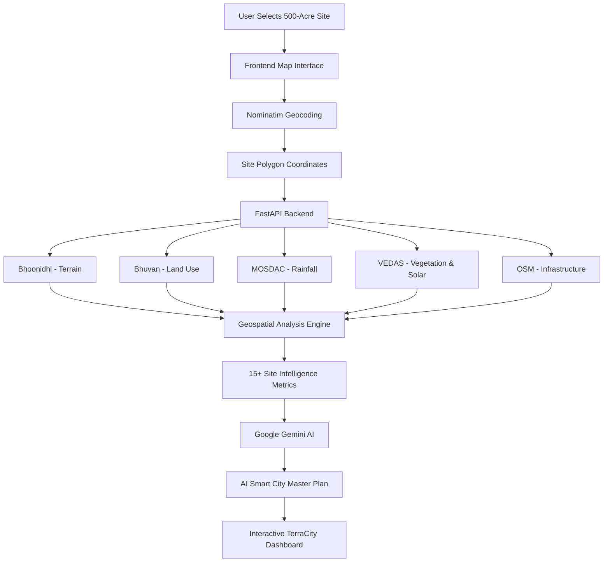

# TerraCity AI

> **AI-Powered Smart City Planning & Land Intelligence Platform**  
> *Tagline: "Designing Sustainable Cities. Intelligence for Tomorrow."*  
> *ASTRA 2026 Hackathon (ANTERiX, VIT Bhopal — Theme: Space)*

[](https://fastapi.tiangolo.com)
[](https://reactjs.org)
[](https://threejs.org)
[](https://python.org)
[](https://deepmind.google/technologies/gemini/)
[](https://www.isro.gov.in)
[](backend/tests/)
[](#offline-mode)

---

## Overview

**TerraCity AI** is an advanced geospatial intelligence and sustainable urban planning platform that empowers state urban development boards, infrastructure planning authorities, and master planners to evaluate greenfield land parcels for new smart cities or industrial townships.

By integrating open satellite feeds from **all four official Indian space portals** into deterministic spatial models, TerraCity AI evaluates land suitability across **7 core intelligence pillars**:

1. **Terrain & Elevation**: CartoDEM 30m slope profiling, buildable envelope share ($\le 15\%$), topographic relief, and Terrain Ruggedness Index (TRI).
2. **Geological & Soil Stability**: VEDAS lithology, soil bearing capacity proxies, and land degradation susceptibility.
3. **Water Availability & Hydrology**: MOSDAC INSAT-3D precipitation climatology, monsoon rainfall coefficient of variation (CV), surface water proximity, and aquifer recharge prospects.
4. **Climate Stress & Future Scenarios**: Multi-decade physical water balance simulations and SSP climate stress testing (2026–2050 trajectories).
5. **Disaster Risks & Statutory Hard-Stops**: Real Bhuvan flood inundation hazard zonation, CartoDEM HAND hydrologic flood proxy ($< 2\text{m}$), BIS IS 1893:2016 seismic zones, and GSI landslide inventories.
6. **Renewable Energy Potential**: VEDAS solar GHI insolation mapping ($4.5\text{--}6.5\text{ kWh/m}^2/\text{day}$) and photovoltaic microgrid suitability.
7. **Sustainable Smart City Master Plan Synthesis**: Parametric land-use allocation (Residential, Commercial/IT, Sponge Parks, Clean Microgrid, Transit/Civic), URDPFI compliance benchmarks, and Google Gemini 3.8 Flash urban reviews.

---

## Key Features & Architectural Capabilities

### 1. Interactive 3D Earth Hero Landing Page
- **Three.js + React Three Fiber (`@react-three/fiber`, `@react-three/drei`)**:
  - Full-fidelity 3D Earth featuring 2K satellite textures: day map, bump elevation, ocean specular reflection, night city lights, and dynamic cloud drift.
  - Custom cyan atmospheric glow shader and stars background.
  - Smooth, continuous auto-rotation with interactive drag-to-rotate `OrbitControls`.
  - Pulsing beacon marker placed precisely on **Dholera, Gujarat** ($22.25^\circ\text{N}, 72.19^\circ\text{E}$).
- **Cinematic Targeting & Navigation**:
  - Clicking **"Start Planning"** stops auto-rotation, smoothly eases and zooms into India and the Dholera marker ($2.0\text{s}$ duration via cubic easing), cross-fades into the satellite map canvas, and transitions directly into the planning dashboard.
  - Respects `prefers-reduced-motion` to bypass animations for accessibility.
  - Code-split lazy loading with an orbital radar ring fallback component (`EarthFallback`).

### 2. Google Gemini 3.8 Flash Spatial Audit & API Inspector
- Powered by `gemini-3.8-flash` (with automated fallback to `gemini-2.5-flash`).
- Dispatches exact polygon boundary coordinates ($N$-point coordinates array), centroid, parcel area (in $\text{km}^2$ and hectares), and $15+$ satellite indicators across all 4 space portals.
- **Live API Transparency Inspector Drawer**: Inspect raw HTTP latency, exact JSON spatial payloads sent, full prompt text, raw Gemini response JSON, and custom API key configuration.

### 3. Persistent Dark & Light Mode with WCAG AAA Contrast
- Seamless theme toggle in the navigation header with `localStorage` persistence and OS `prefers-color-scheme` fallback.
- **Basemap Synchronization**: Automatically toggles Leaflet basemaps between Carto Voyager (light theme) and Carto Dark Matter (dark theme).
- **High-Contrast Styling**: Fully remaps colored text (`text-blue-900`, `text-emerald-900`, `text-amber-900`, `text-rose-900`) to vibrant pastel tones with contrast ratios exceeding $7.5:1$, ensuring crisp legibility on dark card surfaces, tables, Recharts axes, and Leaflet popups.

### 4. Interactive Location Search Bar
- Autocomplete search powered by `/api/geocode` with instant fly-to navigation for any city, district, or landmark across India.
- Supports direct coordinate input (e.g., `22.25, 72.19` or `28.26, 77.74`) and one-click access to featured smart city hubs (Dholera SIR, Jewar Airport, GIFT City, Amaravati, Sriperumbudur).

### 5. Geodesic Polygon Math & Scaled Urban Catchments
- Accurate geodesic Shoelace formula (`computePolygonAreaKm2`) scaled by local latitude cosine.
- Supports candidate parcels up to $3,000\text{ km}^2$ with built-in URDPFI planning scale advisories for macro-regional footprints ($> 250\text{ km}^2$).
- Physically caps urban municipal water catchments at $150\text{ km}^2$ to prevent unrealistic water surpluses during extreme large-polygon screening.

### 6. Symmetrical Right-Panel Navigation Tabs
- Clean 5-column CSS grid (`grid grid-cols-5`) providing equal 20% column widths across all five tabs:
  - **Scorecard**: 5-pillar spider radar chart, suitability tiers, 7-pillar breakdown, and Gemini 3.8 Flash review.
  - **Compare**: Multi-site ranking, score deltas, and sensitivity tie-check alerts.
  - **Stress**: 2026–2050 water demand vs. sustainable supply timeseries trajectories.
  - **Sources**: 4-portal ISRO provenance matrix and dataset confidence tiers.
  - **Report**: Print-ready executive evaluation sheet and standardized GeoJSON export.

---
# TerraCity AI – API Architecture

---

In TerraCity AI, the APIs are divided into two complementary groups:

1. **Upstream Data & AI APIs** – Third-party services providing satellite data, mapping, geospatial intelligence, and AI capabilities.
2. **Platform Backend Endpoints** – Our FastAPI REST APIs responsible for processing data, executing analysis, and serving the frontend application.

## Part 1: Upstream Space, Map & AI APIs

These external APIs provide the core satellite imagery, geospatial datasets, environmental intelligence, and AI capabilities required by TerraCity AI.

| API / Portal | Source / Provider | Purpose in TerraCity AI |
|---|---|---|
| **Bhoonidhi API** | NRSC / ISRO | Terrain & Elevation Analysis |
| **Bhuvan WMS / Geoportal** | NRSC / ISRO | Land Use & Flood Hazards |
| **MOSDAC API** | SAC / ISRO | Hydrology & Precipitation Climatology |
| **VEDAS WMS / API** | SAC / ISRO | Vegetation & Solar Energy Potential |
| **Google Gemini API (gemini-3.8-flash)** | Google AI | AI Urban Planning Co-Pilot & Synthesis |
| **CARTO Basemap API** | CARTO | Vector GIS Base Cartography |
| **OpenStreetMap & Overpass API** | OSM Community | Infrastructure Connectivity |
| **Nominatim Geocoding API** | OpenStreetMap | Map Location Search |

### 1. Bhoonidhi API – Terrain & Elevation Analysis

**Provider:** NRSC / ISRO

- Fetches CartoDEM 30m elevation rasters.
- Calculates:
  - Mean slope.
  - Buildable land share (slope ≤ 15%).
  - Terrain Ruggedness Index (TRI).
  - Elevation profiles.
- Feeds the HAND (Height Above Nearest Drainage) hydrological flood proxy.

### 2. Bhuvan WMS / Geoportal – Land Use & Flood Hazards

**Provider:** NRSC / ISRO

- Queries LULC 1:50K thematic layers.
- Identifies:
  - Agricultural land.
  - Barren land.
  - Built-up areas.
  - Wetlands.
- Evaluates historical flood hazard zonation.
- Detects statutory hard-stops, such as:
  - Protected wetlands.
  - Active floodways.
  - Restricted ecological zones.

### 3. MOSDAC API – Hydrology & Precipitation Climatology

**Provider:** SAC / ISRO

- Uses INSAT-3D / 3DR daily rainfall and Hydro-Estimator data.
- Computes:
  - Annual mean precipitation.
  - Monsoon coefficient of variation (CV).
  - Dry months.
- Drives physical water balance simulations for **2026–2050**.

### 4. VEDAS WMS / API – Vegetation & Solar Energy Potential

**Provider:** SAC / ISRO

- Processes Sentinel-2 (10m) multi-temporal NDVI vegetation index.
- Evaluates ecological sensitivity.
- Analyses multi-year vegetation and greenness trends.
- Extracts Solar Global Horizontal Irradiance (GHI) insolation in kWh/m²/day.
- Supports rooftop solar energy planning and renewable energy recommendations.

### 5. Google Gemini API – AI Urban Planning Co-Pilot

**Provider:** Google AI

- Ingests:
  - Exact site polygon coordinates.
  - Centroid latitude and longitude.
  - 15+ satellite-derived environmental and geographical metrics.
- Generates:
  - Executive planning critiques.
  - Autonomous smart zoning recommendations (hectares + percentages).
  - Phased Capital Expenditure (CapEx) roadmaps (2026–2050).
  - Climate adaptation and mitigation strategies.
  - Space-sensor-informed climate countermeasures.
- Powers real-time AI planning Q&A.
- Uses strict numerical grounding to minimize AI hallucinations.

### 6. CARTO Basemap API – Vector GIS Base Cartography

**Provider:** CARTO

- Delivers high-performance vector map tiles.
- Provides interactive GIS base maps.
- Dynamically switches between:
  - **Carto Voyager:** Light theme.
  - **Carto Dark Matter:** Dark theme.

### 7. OpenStreetMap & Overpass API – Infrastructure Connectivity

**Provider:** OpenStreetMap Community

- Measures proximity and connectivity to:
  - Major arterial highways.
  - Railway lines.
  - Power transmission grids.
  - Airports.
- Helps evaluate infrastructure accessibility and transportation connectivity.

### 8. Nominatim Geocoding API – Map Location Search

**Provider:** OpenStreetMap

- Converts city names and addresses into geographic coordinates.
- Supports direct latitude/longitude coordinate input.
- Enables map location search and smooth fly-to animations.
- Helps users identify and select potential development sites.

## Overall API Integration Workflow


---

## Four-Portal Space Provenance
---

TerraCity AI integrates real data from four official Indian space portals:

```
+-----------------------------------------------------------------------------------------+
|                                      TERRACITY AI                                       |
+-------------------+--------------------+--------------------+---------------------------+
|    BHOONIDHI      |       BHUVAN       |      MOSDAC        |          VEDAS            |
|   (NRSC/ISRO)     |    (NRSC/ISRO)     |    (SAC/ISRO)      |        (SAC/ISRO)         |
+-------------------+--------------------+--------------------+---------------------------+
| CartoDEM 30m DEM  | LULC 1:50k &       | INSAT-3D/3DR Daily | Sentinel-2 Multi-Temporal |
| Stereo-Derived    | Historical Flood   | Precipitation      | NDVI (10m) Time-Series    |
| Surface Model     | Hazard Zonation    | Climatology        | & Solar GHI Insolation    |
+-------------------+--------------------+--------------------+---------------------------+
| • Mean Slope      | • Land Cover Class | • Annual Mean Rain | • Mean NDVI               |
| • Buildable Share | • Wetland Overlap  | • Rainfall CV      | • Multi-Year Trend        |
| • Roughness (TRI) | • Flood Frequency  | • Dry Month Count  | • Ecological Sensitivity  |
| • HAND Proxy      | • Groundwater Pot. | • Drought Exposure | • Solar GHI Potential     |
+-------------------+--------------------+--------------------+---------------------------+
```

---

## Architecture & Tech Stack

- **Backend**: Python 3.11+, FastAPI, Pydantic v2, rasterio, shapely, pyproj, numpy, SQLite analysis store, pyyaml, httpx, pytest (**72/72 tests passing**).
- **AI & Planning Intelligence**: Google Gemini 3.8 Flash (`gemini-3.8-flash` via `/api/ai/review`) with rich spatial boundary payloads, 15+ satellite indicators, live API Transparency Inspector, and deterministic fallback synthesis for intelligent executive critique, autonomous smart zoning allocation, phased CapEx roadmap (2026–2050), and space-grounded climate resilience countermeasures.
- **3D Planetary Canvas**: Three.js, `@react-three/fiber`, `@react-three/drei`, realistic 2K satellite textures, dynamic cloud layers, and atmospheric Fresnel shader.
- **Frontend**: React 19, TypeScript, Vite, Tailwind CSS, Dual-Theme (Light & Dark mode with basemap auto-sync), Leaflet + Geoman, Recharts, Lucide Icons.
- **Data Caching**: Regional COG rasters and GeoJSON vectors stored in `data/cache/regions/` and `data/fixtures/` for 100% offline operation.

---

## Local Run Instructions

### Prerequisites
- Python 3.11+
- Node.js 18+ (with `npm` or `npm.cmd` on Windows)

### 1. Quick Start via Windows PowerShell

Open a PowerShell terminal in the repository root:

```powershell
# Copy environment template
Copy-Item .env.example .env

# Install backend dependencies
python -m pip install -r backend/requirements.txt

# Run backend tests (72/72 passing)
python -m pytest backend/tests -q

# Start FastAPI backend server (Port 8000)
python -m uvicorn backend.app.main:app --host 0.0.0.0 --port 8000 --reload
```

In a second PowerShell terminal:

```powershell
# Navigate to frontend and install dependencies
cd frontend
npm.cmd install

# Start Vite development server (Port 5173)
npm.cmd run dev
```

Open your browser to:
- **Frontend App**: [http://localhost:5173](http://localhost:5173)
- **FastAPI OpenAPI Docs**: [http://localhost:8000/docs](http://localhost:8000/docs)
- **API Health Check**: [http://localhost:8000/api/health](http://localhost:8000/api/health)

### 2. Quick Start via Makefile (Linux / macOS / Git Bash)

```bash
# Setup both backend and frontend
make setup

# Run test suite
make test

# Start backend server
make run-backend

# In another terminal: start frontend
make run-frontend
```

---

## 3-Minute Live Demo Script

Follow this script for a hackathon jury demonstration:

| Time | Segment | Actions to Perform | What to Highlight |
| :---: | :--- | :--- | :--- |
| **0:00 - 0:35** | **Orbital Entry & Landing** | 1. Open the landing page to showcase the **3D interactive Earth globe** rotating with realistic cloud drift, atmosphere glow, and starfield.<br/>2. Drag the globe with your mouse to demonstrate free orbital interaction.<br/>3. Click **"Start Planning"** to watch the smooth 2.0s eased zoom targeting India and the glowing Dholera marker, cross-fading into the GIS dashboard. | Space-first orbital UX, Three.js performance at 60fps, code-split lazy loading, and seamless navigation. |
| **0:35 - 1:10** | **Map, Search & Scoring** | 1. Use the **Location Search Bar** to search for "Dholera SIR" or enter coordinates.<br/>2. Click the **Sun/Moon icon** in the navbar to toggle dark mode (notice the map basemap synchronizes between Voyager and Carto Dark Matter with WCAG AAA text contrast).<br/>3. Select **Site A** in the RightPanel to view its 5-pillar scorecard and Recharts radar profile. | Real-time geodesic area calculation, responsive dark mode with synchronized tiles, and honest 4-portal ISRO indicator provenance. |
| **1:10 - 1:45** | **Compare, Deal-Breakers & Sensitivity** | 1. Switch to the **Compare** tab to view multi-site rankings and winner spotlight.<br/>2. Observe **Site B** flagged with a **Red Deal-Breaker Banner** (Severe Flood Hazard).<br/>3. Toggle priority presets (**Balanced**, **Climate-Resilient**, **Infra-First**) to show live rank sensitivity. | Live MCA rank shifts, deterministic top-3 driver explanations, and tie-check sensitivity alerts. |
| **1:45 - 2:20** | **Gemini 3.8 Flash AI Review** | 1. In the Scorecard tab, open the **Gemini Urban AI Review** section.<br/>2. Click **"Review Site A"** (powered by Gemini 3.8 Flash) to inspect the executive critique, smart land-use zoning breakdown (Residential, Commercial, Sponge Parks, Microgrid), and 3-stage CapEx roadmap.<br/>3. Click **"Inspect API"** to reveal the live **API Transparency Drawer**, showcasing the raw boundary coordinates, centroid, prompt, and response. | Generative AI grounded directly in satellite geometry and ISRO indicators with zero hallucination and complete auditability. |
| **2:20 - 3:00** | **Stress Testing & Export** | 1. Switch to the **Stress** tab to demonstrate the 2026–2050 water demand vs. sustainable supply trajectory.<br/>2. Switch to the **Report** tab, click **"Print / Save PDF"** (clean print CSS preview), and click **"Download GeoJSON"** for GIS interoperability. | Dynamic physical water balance modeling and standardized GIS data export (ready for QGIS, ArcGIS, and CAD). |

---

## Honest Positioning & Non-Goals

- **Targeted Gap**: Early-stage greenfield site screening across terrain, hydrology, and hazard exclusions using authoritative Indian satellite data.
- **Not in Scope**: Micro-level architectural CAD layouts, internal structural engineering, or 100-year absolute certainty predictions.
- **Existing Systems**: We complement—rather than replace—PM GatiShakti (national transport corridor logistics), AMRUT 2.0 (brownfield municipal master plans), and VEDAS Urban Sprawl (historical sprawl monitoring).

---

## License

Built for the **ASTRA 2026 Hackathon**. Open-source under the [MIT License](LICENSE).
